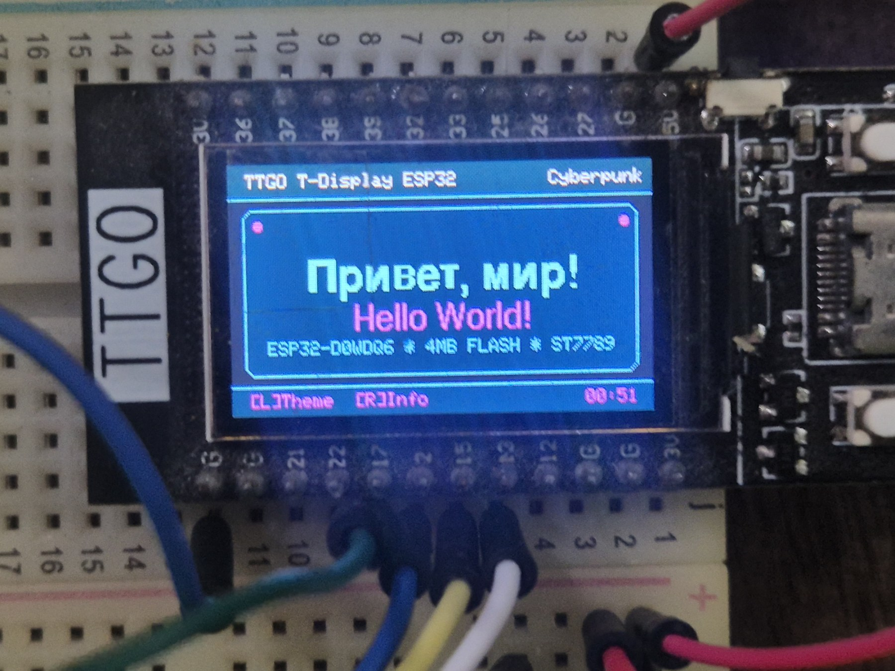

# T-Display

Đủ loại ứng dụng cho chiếc T-Display của tôi.

[](https://kreier.github.io/t-display-again/)
[](https://github.com/kreier/t-display-again/releases/tag/0.2.0)
[](LICENSE)

A collection of applications for the **LilyGO TTGO T-Display** (ESP32 with 4 MB Flash and ST7789 1.14" 240x135 IPS display).

🌐 **Online Web Installer**: Flash the firmware straight from your browser without installing Python, Arduino, or drivers: **[https://kreier.github.io/t-display-again/](https://kreier.github.io/t-display-again/)**

---

## Hello World in Russian (Привет, мир!) & Vietnamese (Xin chào thế giới!)

Version `0.2.0` features dedicated support for both **Russian** (`Привет, мир!`) and **Vietnamese** (`Xin chào thế giới!`) with custom embedded fonts, tone marks, full diacritics, color themes, and runtime language toggling.

```
+--------------------------------------------------+
| TTGO T-Display [VI]                    Cyberpunk |
|--------------------------------------------------|
|  *                                            *  |
|                                                  |
|               Xin chào thế giới!                 |
|                  Hello World!                    |
|                                                  |
|       ESP32-D0WDQ6 * 4MB FLASH * ST7789          |
|--------------------------------------------------|
| [L]Theme  [R]Info                          00:42 |
+--------------------------------------------------+
```



### Features

- 🇷🇺 **Full Russian Cyrillic Support**: UTF-8 decoding rendered with embedded anti-aliased FreeSans fonts (`FreeSansBold12pt8b` and `FreeSans9pt8b`).
- 🇻🇳 **Full Vietnamese Diacritics Support**: Complete tone marks and accented vowels (`à, á, ả, ã, ạ, ă, â, đ, ê, ô, ơ, ư, ...`) rendered via `VietnameseSansBold12pt8b`, `VietnameseSans9pt8b`, and `VietnameseEncoder`.
- 🔄 **On-Device Language Switcher**: Hold Button 2 (GPIO 35) for >1.5s to toggle between Russian and Vietnamese at any time.
- 🎨 **5 Selectable Color Themes**:
  1. **Cyberpunk**: Neon cyan and magenta accents on midnight dark.
  2. **Emerald**: Classic Matrix green on charcoal.
  3. **Sunset**: Vibrant amber gold and coral on dark navy.
  4. **Nordic Ice**: Glacier white and cyan on slate blue.
  5. **Amber CRT**: Retro phosphor amber on pure black.
- 📱 **3 Interactive Screens**:
  - **Greeting Card**: "Привет, мир!" or "Xin chào thế giới!" headline, "Hello World!" subtitle, and board badge.
  - **System Diagnostics**: Live ESP32 CPU clock frequency (240 MHz), Flash size (4 MB), free heap memory, active language, and SDK version.
  - **Alphabet Showcase**: Russian Cyrillic (`А-Я`, `а-я`, `Ё`, `ё`) or Vietnamese alphabet test with tone marks.
- 🔄 **180° Display Rotation**: Hold Button 1 for >1.5s to flip orientation on the fly so the USB port can be on the left or right.
- ⏱️ **Live Footer**: Real-time MM:SS uptime counter refreshed without screen flickering.
- 📦 **Browser Web Installer**: Choose your language directly on [GitHub Pages](https://kreier.github.io/t-display-again/) and install in 1 click!

---

## Hardware Specifications & Pinout

The original **LilyGO TTGO T-Display** is powered by an Espressif ESP32-D0WDQ6 chip and features an onboard 1.14-inch IPS LCD.

| Component | ESP32 GPIO Pin | Description |
| :--- | :--- | :--- |
| **TFT MOSI** | `GPIO 19` | SPI Data Out |
| **TFT SCLK** | `GPIO 18` | SPI Clock |
| **TFT CS** | `GPIO 5` | SPI Chip Select |
| **TFT DC** | `GPIO 16` | Data / Command Control |
| **TFT RST** | `GPIO 23` | Display Reset |
| **TFT Backlight** | `GPIO 4` | Backlight power (Active HIGH) |
| **Button 1 (Left / Top)** | `GPIO 0` | Boot button (Active LOW, internal pull-up) |
| **Button 2 (Right / Bottom)** | `GPIO 35` | Auxiliary button (Active LOW, input-only) |
| **Battery ADC** | `GPIO 34` | Voltage divider for battery monitoring |

---

## Controls

| Action | Control | Function |
| :--- | :--- | :--- |
| **Short Press Button 1** (GPIO 0) | Left / Top Button | Cycle through 5 color themes |
| **Long Press Button 1** (>1.5s) | Left / Top Button | Rotate display 180° (USB left / right) |
| **Short Press Button 2** (GPIO 35) | Right / Bottom Button | Switch screen (Greeting &rarr; System Info &rarr; Alphabet) |
| **Long Press Button 2** (>1.5s) | Right / Bottom Button | **Toggle Language** (Russian 🇷🇺 &harr; Vietnamese 🇻🇳) |

---

## How to Flash & Install

### Method 1: Web Installer (Fastest & Easiest)

No software, libraries, or drivers needed!

1. Open **[https://kreier.github.io/t-display-again/](https://kreier.github.io/t-display-again/)** in **Google Chrome**, **Microsoft Edge**, or **Opera** on desktop.
2. Select your preferred edition:
   - 🇷🇺 **Russian** (`Привет, мир!`)
   - 🇻🇳 **Vietnamese** (`Xin chào thế giới!`)
3. Connect your LilyGO TTGO T-Display via USB-C.
4. Click **Connect & Flash**, select your serial device port, and confirm the installation.

---

### Method 2: PlatformIO

This repository includes a ready-to-use `platformio.ini` configured with build targets for both editions:

```bash
# Build and upload Russian version:
pio run -e ttgo-t-display-ru -t upload

# Build and upload Vietnamese version:
pio run -e ttgo-t-display-vi -t upload
```

Open Serial Monitor (115200 baud):
```bash
pio device monitor
```

---

### Method 3: Arduino IDE

1. Open Arduino IDE and install the **ESP32** board package (`esp32` by Espressif).
2. Install the **TFT_eSPI** library via the Library Manager.
3. Configure `TFT_eSPI` for the TTGO T-Display:
   - Navigate to your Arduino libraries folder: `libraries/TFT_eSPI/User_Setup_Select.h`
   - Comment out `#include <User_Setup.h>`
   - Uncomment `#include <User_Setups/Setup25_TTGO_T_Display.h>`
4. In Arduino IDE:
   - Board: **ESP32 Dev Module**
   - Flash Size: **4MB (32Mb)**
   - Upload Speed: **921600** (or 115200)
5. Open [`firmware/hello_world.ino`](firmware/hello_world.ino) and click **Upload**.

---

### Method 4: Esptool (Precompiled Binaries)

You can flash precompiled standalone images with a single command:

```bash
# Flash Russian edition:
esptool.py --chip esp32 write_flash 0x0 bin/merged-firmware-ru.bin

# Flash Vietnamese edition:
esptool.py --chip esp32 write_flash 0x0 bin/merged-firmware-vi.bin
```

---

## How Multi-Language UTF-8 Text Works

Standard Arduino graphics fonts only contain ASCII codes (0x20 to 0x7E). Both Russian and Vietnamese use multi-byte UTF-8 encoding:

1. **Russian Cyrillic**: 2-byte sequences (`0xD0`/`0xD1`) decoded by `utf8rus()`.
2. **Vietnamese Diacritics**: 2-byte and 3-byte sequences (Latin-1 Supplement and Latin Extended Additional) decoded by `utf8viet()`.

By disabling TFT_eSPI's internal multi-byte decoder (`tft.setAttribute(UTF8_SWITCH, false);`), strings passed through `utf8rus()` or `utf8viet()` map directly to the embedded glyph tables with zero flash filesystem overhead.

---

## Project Structure

```
├── .github/workflows/deploy.yml # Automated GitHub Pages deployment
├── .gitignore                   # Git ignore rules (build files, .pio, etc.)
├── .nojekyll                    # Bypass Jekyll for direct static file serving
├── LICENSE                      # MIT License
├── README.md                    # Project documentation
├── index.html                   # Web Installer webpage (ESP Web Tools)
├── manifest-ru.json             # Manifest for Russian edition
├── manifest-vi.json             # Manifest for Vietnamese edition
├── manifest.json                # Default manifest
├── platformio.ini               # PlatformIO dual-environment configuration
├── bin/                         # Precompiled binaries
│   ├── bootloader.bin           # ESP32 second-stage bootloader (0x1000)
│   ├── partitions.bin           # Partition table (0x8000)
│   ├── boot_app0.bin            # OTA data initial bootloader state (0xe000)
│   ├── firmware-ru.bin          # Russian application binary (0x10000)
│   ├── firmware-vi.bin          # Vietnamese application binary (0x10000)
│   ├── merged-firmware-ru.bin   # Russian combined 4MB flash image (0x0)
│   └── merged-firmware-vi.bin   # Vietnamese combined 4MB flash image (0x0)
└── firmware/
    ├── hello_world.ino          # Main application source code (RU & VI)
    ├── FreeSansBold12.h         # 12pt Bold Cyrillic GFX font
    ├── FreeSans9.h              # 9pt Cyrillic GFX font
    ├── VietnameseSansBold12.h   # 12pt Bold Vietnamese GFX font
    ├── VietnameseSans9.h        # 9pt Vietnamese GFX font
    └── VietnameseEncoder.h      # Fast UTF-8 Vietnamese tone mark decoder
```

---

## License

This project is licensed under the [MIT License](LICENSE).
